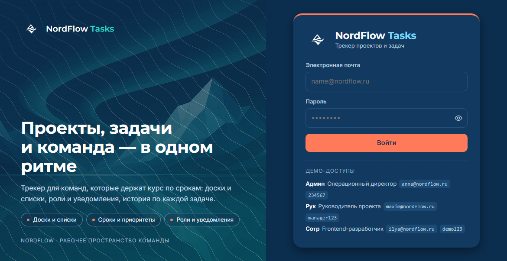
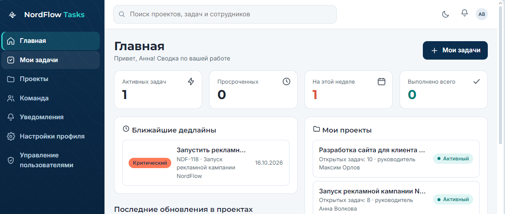
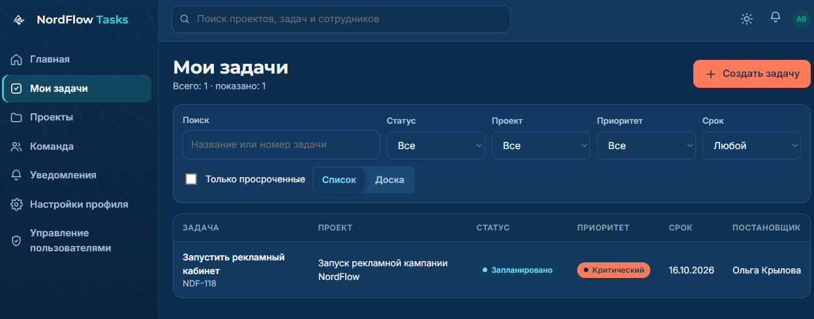
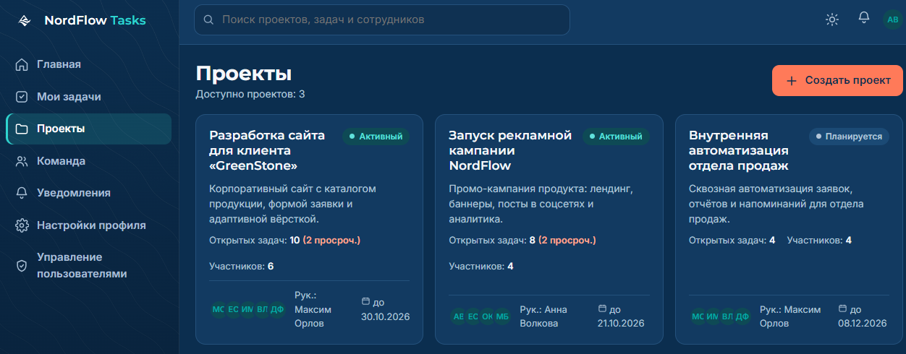
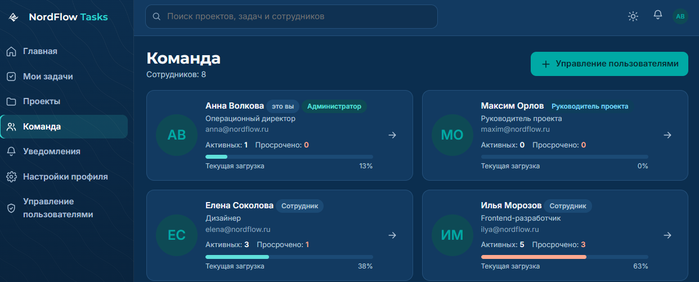
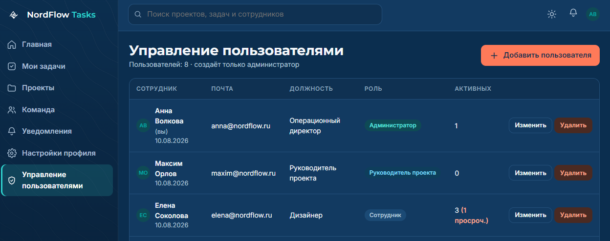
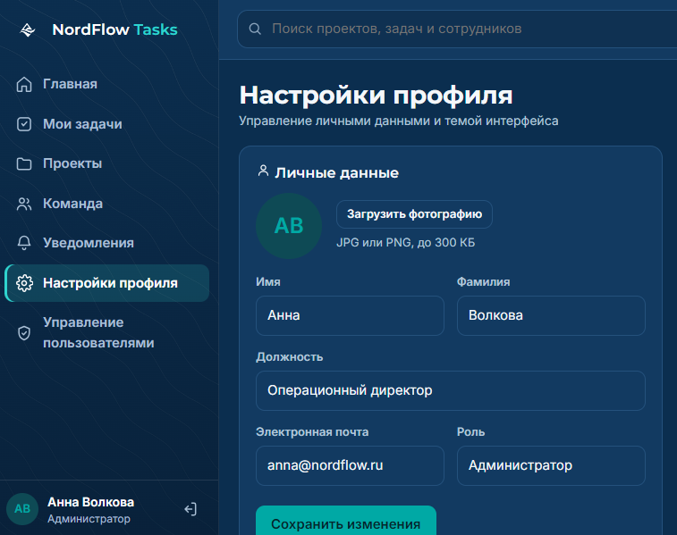

# NordFlow Tasks

Трекер проектов и задач для команд: доски и списки, роли и уведомления, история изменений по каждой задаче. Фирменный стиль — по брендбуку NordFlow (Deep Fjord, Aurora Teal, Glacier, Northern Sun).

Статичное приложение без сборки и зависимостей: чистые HTML, CSS и JavaScript, данные хранятся в `localStorage` браузера.

## Какая задача решается

Команды малого и среднего бизнеса часто теряют контроль над задачами: статусы живут в чатах и таблицах, дедлайны всплывают в последний момент, руководитель не видит нагрузку, а сотрудник не понимает, за что он отвечает.

**NordFlow Tasks** решает это одной рабочей средой: единая доска и список задач, статусы и приоритеты, дедлайны, роли и уведомления, история по каждой задаче — без регистрации, сервера и платных подписок.

## Для кого сделан проект

- **Небольшие команды** (3–20 человек), которым нужен простой трекер без настройки
- **Руководители проектов** — видеть дедлайны, нагрузку и прогресс
- **Сотрудники** — понимать свои задачи, приоритеты и историю обсуждений
- **Владельцы бизнеса** — держать несколько проектов в одном месте

## Возможности

- **Вход и роли** — администратор, руководитель проекта, сотрудник; права на создание/редактирование проектов, задач и пользователей.
- **Главная** — сводка: активные и просроченные задачи, ближайшие дедлайны, мои проекты, нагрузка команды.
- **Мои задачи** — список или доска, фильтры (статус, проект, приоритет, срок, только просроченные), поиск.
- **Проекты** — карточки проектов, страница проекта с вкладками «Доска», «Список задач», «Участники», «Информация о проекте».
- **Задача** — описание, статус/приоритет/исполнитель/дедлайн, вложения и ссылки, комментарии, история изменений.
- **Команда** — сотрудники, роли, текущая нагрузка; управление пользователями (только для администратора).
- **Уведомления** — системные уведомления о смене статусов и дедлайнах, счётчик в меню.
- **Профиль** — редактирование данных, смена пароля, выбор светлой/тёмной темы.
- **Глобальный поиск** — по проектам, задачам и сотрудникам прямо из шапки.
- **Тёмная тема** и адаптивная вёрстка (десктоп, планшет, мобильные экраны).

## Скриншоты

### Экран входа — роли и демо-доступы

<p align="center">
  
</p>

### Главная — сводка по работе, дедлайны и проекты

<p align="center">
  
</p>

### Мои задачи — фильтры, список и доска

<p align="center">
  
</p>

### Проекты — карточки с дедлайнами и участниками

<p align="center">
  
</p>

### Команда — роли и нагрузка сотрудников

<p align="center">
  
</p>

### Управление пользователями — только для администратора

<p align="center">
  
</p>

### Настройки профиля — личные данные и тема

<p align="center">
  
</p>

## Запуск

Сборка не нужна.

1. Откройте `index.html` в браузере (двойной клик) — приложение работает и через `file://`.
2. Либо поднимите локальный сервер в корне проекта:
   ```bash
   python -m http.server 8000
   # или
   npx serve .
   ```
   и откройте `http://localhost:8000`.

## Демо-доступы

| Роль | Почта | Пароль |
|---|---|---|
| Администратор | `anna@nordflow.ru` | `admin123` |
| Руководитель проекта | `maxim@nordflow.ru` | `manager123` |
| Сотрудник | `ilya@nordflow.ru` | `demo123` |

Остальные сотрудники — пароль `demo123` (список виден на экране входа).

## Структура проекта

```
Tracker/
├── index.html          # каркас: экран входа, обложка, сайдбар, шапка
├── css/
│   └── styles.css      # все стили, переменные тем, медиазапросы
├── js/
│   ├── helpers.js      # утилиты: DOM, форматирование, иконки, аватары
│   ├── seed.js         # демо-данные (пользователи, проекты, задачи)
│   ├── store.js        # состояние, права, операции над данными
│   ├── views-auth.js   # экран входа
│   ├── views-main.js   # главная
│   ├── views-tasks.js  # задачи, фильтры, доска, карточка задачи
│   ├── views-projects.js # проекты и страница проекта
│   ├── views-people.js # команда, профиль, управление пользователями
│   └── app.js          # маршрутизация, тема, модалки, поиск, chrome
├── fonts/              # Montserrat и Inter (woff2, кириллица/латиница)
├── Info/               # логотипы, обложка, паттерн, иконка вкладки
├── assets/
│   └── screens/        # скриншоты интерфейса для README
└── README.md
```

## Данные

- Хранилище: `localStorage`, ключ `nordflow_tasks_v1` (тема — `nordflow_theme`).
- При первом запуске создаются демо-данные (8 пользователей, 3 проекта, 30 задач).
- Сброс к исходному состоянию: `Store.resetAll()` в консоли браузера или очистка данных сайта.

## Дизайн

- **Палитра:** Deep Fjord `#0B2E4F`, Aurora Teal `#00A9A5`, Glacier `#4CC9F0`, Northern Sun `#FF7A59`, Graphite `#1B2735`, Snow `#F4F7FA` (60/30/10).
- **Шрифты:** Montserrat — заголовки, Inter — текст; подключены локально из `fonts/`, интернет не нужен.
- **Логотип:** `Info/logo_mark.png` (светлая тема), `Info/logo_mark_white.png` (тёмная), иконка вкладки — `Info/logoicon.png`.
- **Экран входа:** обложка слева (`Info/coverhero.png` + паттерн `Info/patternbg.png` + белый знак), форма справа; на мобильных обложка скрывается, фон становится полноэкранным.
- **Темы:** светлая (Snow) и тёмная (Deep Fjord/Graphite), переключаются в шапке и в настройках профиля.

## Поддержка браузеров

Последние версии Chrome, Edge, Firefox, Safari (используются CSS Grid, `clamp()`, `:focus-visible`, `dvh`).

## Примечания

- Приложение не отправляет данные на сервер — всё остаётся в браузере.
- Хэш-маршрутизация: `#/dashboard`, `#/my-tasks`, `#/projects`, `#/projects/:id`, `#/tasks/:id`, `#/team`, `#/notifications`, `#/settings`, `#/users`.
